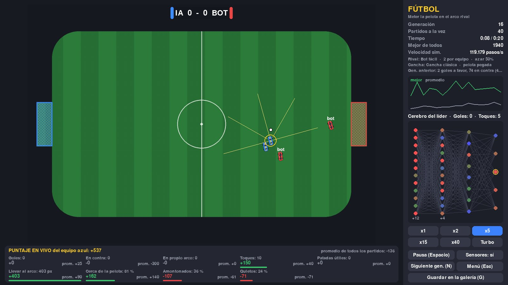
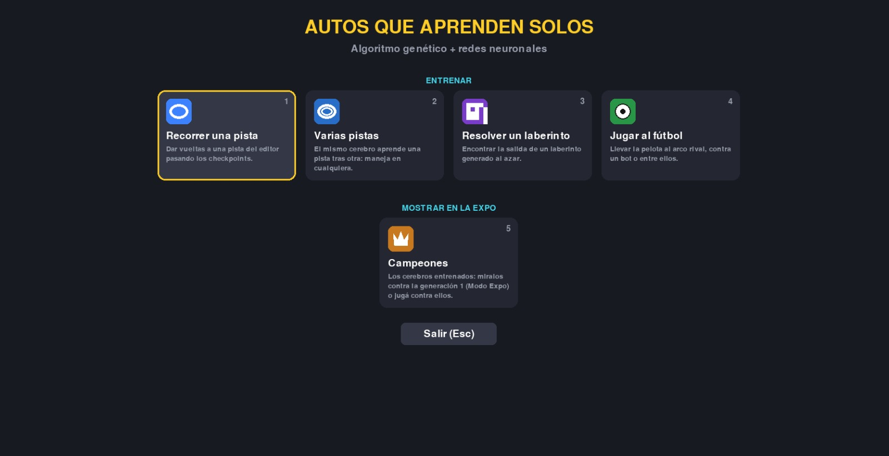
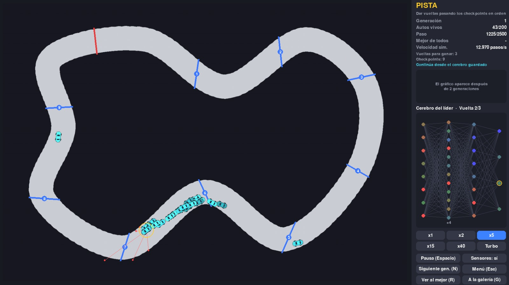
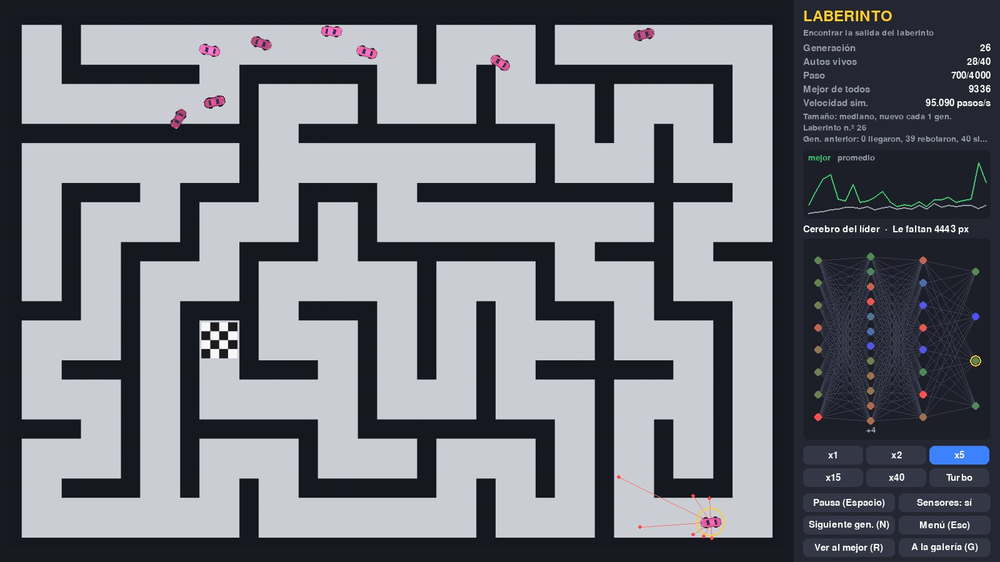
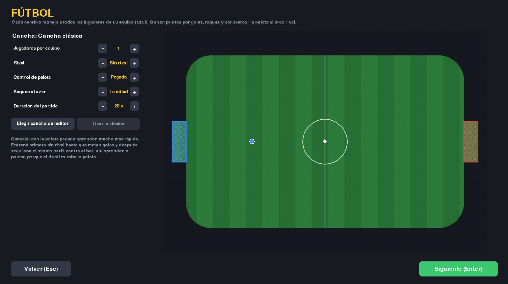
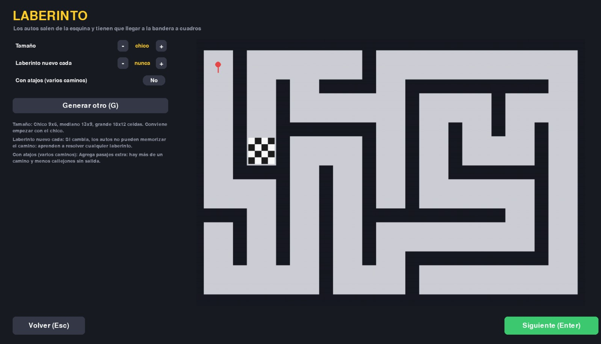
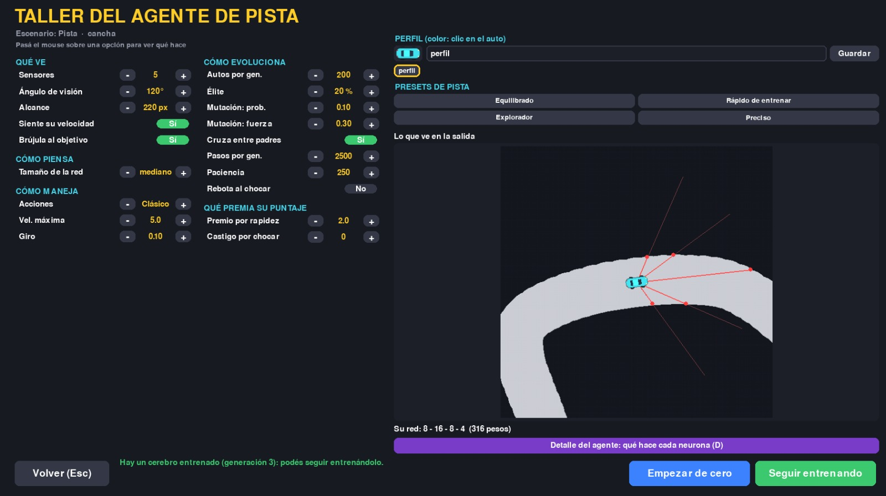
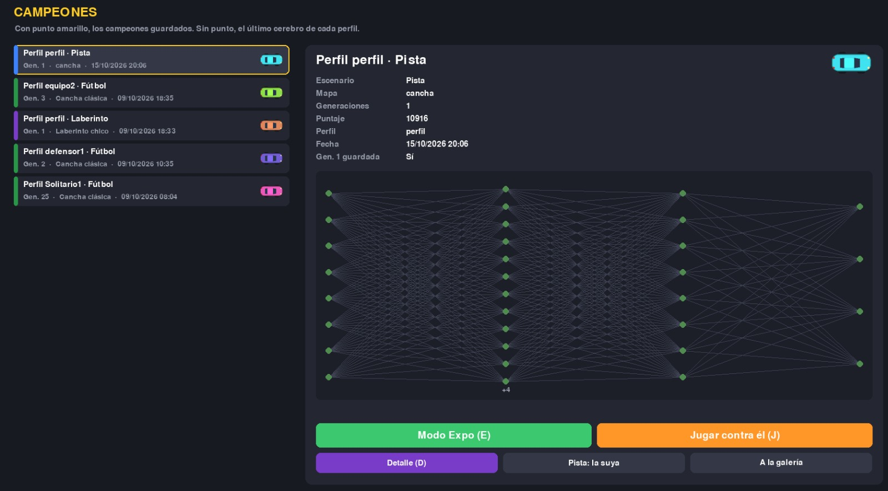
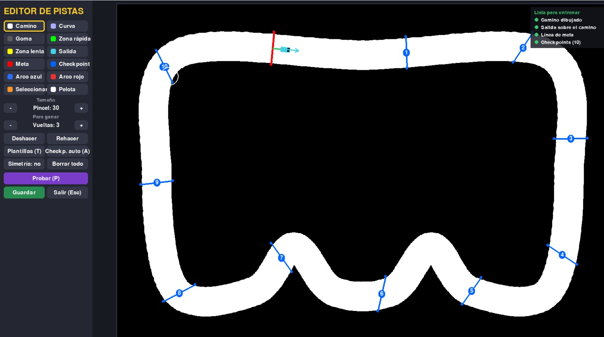
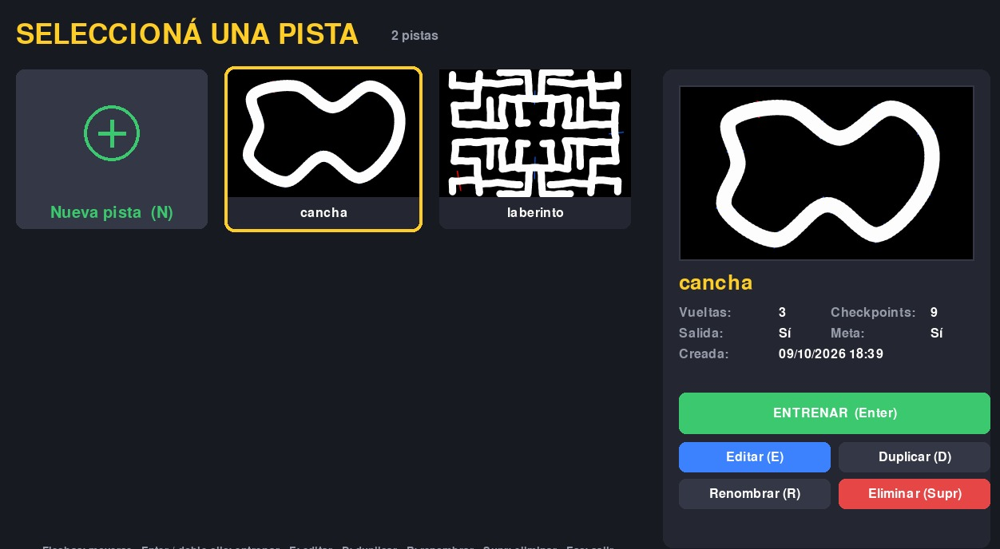

<h1 align="center">🏎️ Autos que aprenden solos</h1>

<p align="center">
  <b>Algoritmo genético + redes neuronales</b><br>
  Autos que aprenden a recorrer pistas, salir de laberintos y jugar al fútbol, sin que nadie les enseñe cómo.
</p>

<p align="center">
  
  
  
  
</p>

<p align="center">
  
</p>

Proyecto para la **Expo UNSTA 2026**, pensado para mostrarles a estudiantes de secundaria cómo una máquina
puede aprender por prueba y error. Cada auto tiene una pequeña red neuronal como cerebro. Al principio manejan
al azar; generación tras generación, los mejores tienen "hijos" parecidos a ellos y, en pocos minutos, el grupo
aprende a manejar.

---

## Contenido

- [Cómo aprenden](#cómo-aprenden)
- [Qué se puede hacer](#qué-se-puede-hacer)
- [Instalación y uso](#instalación-y-uso)
- [Controles](#controles)
- [Estructura del proyecto](#estructura-del-proyecto)

---

## Cómo aprenden

| Paso | Qué pasa |
|---|---|
| **1. Ver** | Cada auto "ve" con rayos (sensores) que miden la distancia a las paredes. También puede saber su velocidad y hacia dónde queda el objetivo. |
| **2. Decidir** | Esos números entran a su red neuronal, que elige una acción: acelerar, doblar, frenar o patear. |
| **3. Puntuar** | Al final de la generación, cada auto recibe un puntaje: cuánto avanzó, si llegó, cuántos goles hizo… |
| **4. Evolucionar** | Los mejores pasan sin cambios (élite) y el resto se reemplaza por hijos que mezclan a dos padres y tienen pequeñas mutaciones. |

La simulación está **vectorizada con numpy**: toda la población se mueve y piensa a la vez. En modo Turbo
entrena unas 100 veces más rápido que la primera versión hecha con PyTorch.

---

## Qué se puede hacer

<p align="center">
  
</p>

### Entrenar

<table>
  <tr>
    <td width="50%" valign="top">
      <h4>🏁 Recorrer una pista</h4>
      <br>
      Dar vueltas a una pista del editor pasando los checkpoints en orden. Con <b>varias pistas</b>, el mismo
      cerebro aprende una lista de pistas y pasa a la siguiente cuando domina la actual.
    </td>
    <td width="50%" valign="top">
      <h4>🧩 Resolver un laberinto</h4>
      <br>
      Laberintos generados al azar (chico, mediano o grande) que pueden cambiar cada N generaciones. El preset
      <b>Sigue paredes</b> aprende la regla de la mano derecha y resuelve laberintos que nunca vio.
    </td>
  </tr>
  <tr>
    <td width="50%" valign="top">
      <h4>⚽ Jugar al fútbol</h4>
      <br>
      Pelota con física, patada y equipos de 1 a 6 jugadores, sin rival, contra un bot o entre ellos. Se elige si la
      pelota queda <b>pegada</b> al auto o es libre, y los <b>saques al azar</b> evitan que memoricen una jugada.
      Mientras entrenan se ve el <b>puntaje en vivo</b> separado por concepto (la imagen del principio).
    </td>
    <td width="50%" valign="top">
      <h4>🗺️ Laberintos a medida</h4>
      <br>
      Tamaño, cada cuántas generaciones cambia el laberinto y si tiene atajos con varios caminos. Al chocar, los
      autos rebotan y siguen, así aprenden a darse vuelta en los callejones sin salida.
    </td>
  </tr>
</table>

Durante el entrenamiento se ve la red neuronal del líder en vivo, un gráfico del mejor puntaje y del promedio, y
se puede ver la **repetición** del mejor de cada generación.

### El taller del agente

<p align="center">
  
</p>

Antes de entrenar se arma el agente: **qué ve** (sensores, ángulo, alcance, brújula), **cómo piensa** (tamaño de
la red), **cómo maneja** y **cómo evoluciona** (población, élite, mutación, paciencia, rebote al chocar), además de
**qué premia su puntaje**. Cada tipo de agente tiene 4 presets listos y se guarda como perfil. Con **D** se abre el
detalle del agente, que explica qué hace cada neurona de entrada y de salida.

### Mostrar en la Expo

<p align="center">
  
</p>

- **Modo Expo (E):** pantalla dividida con un auto típico de la generación 1 contra el campeón. Muestra en
  segundos todo lo que aprendió.
- **Jugar contra él (J):** manejás con las flechas contra un cerebro entrenado, en una pista, un laberinto o un
  partido de fútbol.
- **Galería:** los campeones guardados con **G** durante el entrenamiento, más el último cerebro de cada perfil.

### Editor y selector de pistas

<table>
  <tr>
    <td width="50%" valign="top">
      <br>
      <b>Editor:</b> camino, curvas, goma, zonas rápidas y lentas, salida, meta, checkpoints (también automáticos),
      arcos y pelota para fútbol, plantillas, simetría, zoom, deshacer, y <b>Probar (P)</b> para manejar la pista
      antes de guardarla.
    </td>
    <td width="50%" valign="top">
      <br>
      <b>Selector:</b> vista previa y datos de cada pista, con botones para entrenar, editar, duplicar, renombrar y
      eliminar (con papelera para deshacer).
    </td>
  </tr>
</table>

---

## Instalación y uso

Requiere **Python 3.10 o superior**.

```bash
git clone https://github.com/AgustinSappia/car_Agent-reinforcement-learning.git
cd car_Agent-reinforcement-learning
pip install pygame numpy
python train.py
```

`train_genetic2.py` es un atajo a `train.py`. Las pistas se guardan en `tracks/`, los perfiles y cerebros en
`agentes/` y los registros de entrenamiento en `logs/`.

> 💡 **Consejos:** empezá con un laberinto chico o una pista simple y el preset *Rápido de entrenar*. En fútbol,
> entrená primero sin rival hasta que metan goles y después seguí con el mismo perfil contra el bot.

---

## Controles

| Dónde | Tecla | Acción |
|---|---|---|
| Entrenamiento | `1` a `6` | Velocidad (x1, x2, x5, x15, x40, Turbo) |
| | `Espacio` | Pausa |
| | `N` | Pasar a la siguiente generación |
| | `S` | Mostrar u ocultar sensores |
| | `R` | Ver la repetición del mejor |
| | `G` | Guardar el campeón en la galería |
| Campeones | `E` / `J` / `D` | Modo Expo / Jugar contra él / Detalle |
| Jugar contra la IA | Flechas | Manejar (en fútbol, `Espacio` patea) |
| Selector de pistas | `N` `E` `D` `R` `Supr` | Nueva, editar, duplicar, renombrar, eliminar |
| Editor | `P` / `T` / `A` / `M` | Probar, plantillas, checkpoints automáticos, simetría |
| | `Ctrl+Z` / `Ctrl+Y` / `Ctrl+S` | Deshacer, rehacer, guardar |
| Todas las pantallas | `Esc` | Volver |

---

## Estructura del proyecto

```
train.py               Punto de entrada: menú principal, taller, entrenamiento y Expo
track_editor_v3.py     Editor de pistas y canchas
track_selector.py      Selector de pistas
ai/
├── config.py          Perfil del agente y presets por tipo
├── brain.py           Redes de toda la población en numpy (evolución, cruza y mutación)
├── world.py           Física de los autos y sensores vectorizados
├── scenarios.py       Pista, varias pistas y laberinto
├── football.py        Fútbol: pelota, partidos en paralelo y bots
├── football_trainer.py
├── trainer.py         Pantalla de entrenamiento genético
├── show.py            Modo Expo y jugar contra la IA
├── hall.py            Galería de campeones
├── detail.py          Detalle del agente (qué hace cada neurona)
└── menus.py, ui.py    Menús e interfaz
```

Los archivos `main.py`, `environment.py`, `gym_env.py`, `model.py` y `train_dqn.py` son de la primera versión
del proyecto, un entorno estilo Gym pensado para aprendizaje por refuerzo con DQN (PyTorch). Necesitan las
dependencias de `requirements.txt` y no son necesarios para el programa principal.

---

<p align="center">Hecho por <a href="https://github.com/AgustinSappia">AgustinSappia</a> para la Expo UNSTA 2026</p>
